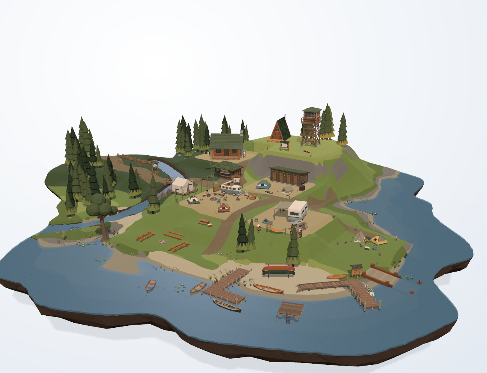

# hometown · v6 · Campground & Lake

把 [polyfork 的 Campground & Lake kit](https://polyfork.dev/kit/campground-lake-ad32b0) 那张单文件场景
GLB（19.87 MB / 533 mesh / 162k tris）搬进 Godot 4.7：默认视角、背景、光照与官网 three.js 观看器逐项对齐，
另带一套可拖放的地图编辑器、4 个会走动的角色，桌面与 Android 都能跑。



叠图比对（1246×956，同机同尺寸）：`mean|diff| = 3.53/255`（1.4%），模型区三通道比值
`0.997 / 1.004 / 1.005`，残差集中在抗锯齿边缘。

本仓库只收 v6 这一条线，工程在 `v6/` 下。

## 跑起来

需要 Godot **4.7**（标准版即可），脚本用 pwsh。

```powershell
# 首次：先导入 GLB（克隆下来没有 .godot/imported），再拆成 174 个可摆放的 part（约 17 MB）
godot --headless --path v6 --import
godot --headless --path v6 -s res://tools/split_parts.gd

pwsh v6/tools/run.ps1          # 开窗：左键拖动环绕 / 滚轮朝光标放大 / 方向键微调 / R 复位
pwsh v6/tools/shot.ps1         # 出静帧 → .run/v6-shots/kit.png
pwsh v6/tools/edit.ps1         # 地图编辑器：拖动摆放、旋转缩放、增删复制、存 map.json
pwsh v6/tools/build_apk.ps1    # 出 Android APK（包名 hometown.wulie.tech，arm64）
```

手机上：单指拖 = 环绕，双指捏合 = 缩放，双指一起拖 = 平移。

## 里面有什么

| 位置 | 内容 |
|---|---|
| `v6/project.godot` | 1246×956 / Forward+ / MSAA 4x / 4096 方向光阴影 |
| `v6/scripts/main.gd` | 载地图、包围盒、环境与光、轨道相机、接触阴影烘焙、出静帧 |
| `v6/scripts/editor.gd` | 地图编辑器：选中 / 拖动 / 旋转 / 缩放 / 增删复制 / 撤销 / 存盘 + HUD |
| `v6/scripts/map_world.gd` | 地图 JSON 读写、part 解析（`parts_over/` 覆盖优先）、拼装 |
| `v6/scripts/actors.gd` | 4 个角色（护林员 / 提手电的小孩 / 背包客 / 钓鱼客）的程序化步态与游走 |
| `v6/shaders/` | 半球光等价物、地面接影 |
| `v6/data/look.json` | 全部可调参数：相机、背景渐变、光、接触阴影（改参数不用改代码） |
| `v6/tools/` | 运行 / 出图 / 编辑 / 拆件 / 校验 / 标定 / 拼图比对 |

## 文档

- [v6/README.md](v6/README.md) —— 与页面 viewer.js 的参数逐项对照、三条实测结论、性能分项、已知差异
- [v6/docs/对齐记录.md](v6/docs/对齐记录.md) —— 对齐过程与每次差异的来源
- [v6/docs/地图与模型.md](v6/docs/地图与模型.md) —— 拆件器、part 覆盖、角色与编辑器
- [v6/docs/性能.md](v6/docs/性能.md) —— 帧时与 draw call 分项、优化顺序

## 性能（同机实测）

| 平台 | 分辨率 | 帧时 | fps | draw calls |
|---|---|---|---|---|
| vivo V2458A（Mali-G925） | 2800×1260 | 16.6 ms | 60（vsync 锁） | 1074 |
| 同上，wm size 降到 1/4 像素 | 1400×630 | 8.38 ms | 119 | 1074 |
| GTX 1050 Ti 桌面 | 1246×956 | 5.88 ms | 170 | 1078 |

瓶颈是 draw call（174 个 part 各一套网格、没合批），不是像素，也不是人物（−0.15 ms）或接触阴影（−0.32 ms）。
