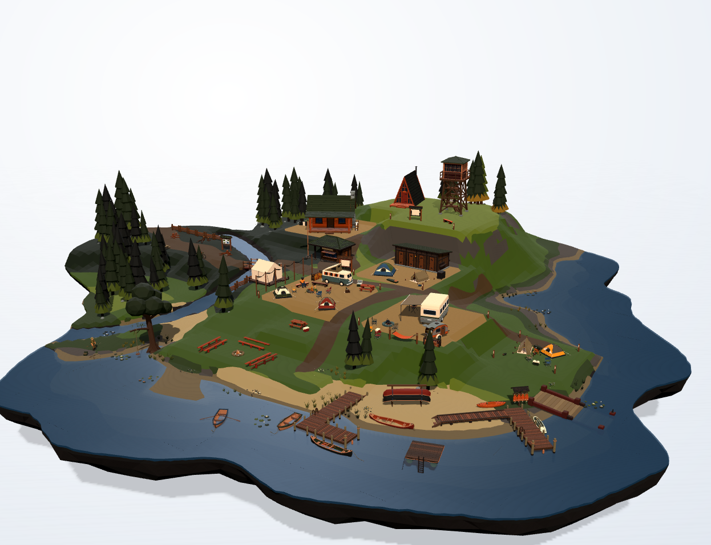

# v6 · Web（浏览器）

Godot 4.7 的 Web 导出：把露营岛场景打成一组静态文件，浏览器里直接开，
不用装 Godot、不用装 APK。工程里新增的是 `Web` 导出预设和两个工具脚本，
`project.godot` 不用改——Web 平台在 Godot 里默认就用 `gl_compatibility`（WebGL2）。



## 构建

前置：Godot **4.7.2**（和桌面/Android 同一份），以及同版本的 export templates。
模板路径沿用现有脚本的约定：`<仓库>/.run/appdata/export_templates/`。

```powershell
pwsh v6/tools/build_web.ps1            # → dist/web/
pwsh v6/tools/build_web.ps1 -Out dist/web-preview
```

脚本做三件事：`--import` 导入资源 → 缺 `assets/parts/` 时自动跑一次拆件器 →
`--export-release "Web"` 出静态文件。Godot 不在默认路径（或 Linux 下）时用
`-Godot /path/to/godot` 覆盖。产物（本机 4.7.2 实测）：

| 文件 | 体积 | 说明 |
|---|---|---|
| `index.html` / `index.js` / `index.audio*.js` | ~300 KB | 启动壳与加载器 |
| `index.wasm` | 39.5 MB | Godot 运行时，gzip 后 10.1 MB |
| `index.pck` | 19.9 MB | 场景 + part 库 + look.json，gzip 后 9.7 MB |
| `index.png` / `index.icon.png` | ~320 KB | 启动图与图标 |

首屏要下 ~60 MB（未压缩）。静态托管记得开 gzip/brotli，能压到 ~20 MB。

## 本地预览

```powershell
python v6/tools/serve_web.py          # http://127.0.0.1:5173
python v6/tools/serve_web.py --host 0.0.0.0 --port 8000   # 局域网/手机
```

默认端口 **5173** 是部署里 dev 隧道的约定（容器 `127.0.0.1:5173` →
`https://dev.wulie.tech`，外面套 Authelia 登录）。服务器顺手处理了三件容易踩坑的事：

- `.wasm` 用 `application/wasm` 发（发错浏览器会退回慢速编译）；
- 带 `Cross-Origin-Opener-Policy: same-origin` 和 `Cross-Origin-Embedder-Policy: require-corp`；
- 不缓存（开发用；线上交给托管/CDN）。

## 部署

`dist/web/` 是纯静态目录，丢到任何静态托管即可。注意：

- **不要用 `file://` 直接开 `index.html`**，`fetch`/`WebAssembly.instantiateStreaming` 会被浏览器拦。
- 预设里 `variant/thread_support=false`（Godot 4.7 的默认）：**不需要** COOP/COEP，
  GitHub Pages 这类加不了响应头的托管也能跑。
- 如果改成 `true`（线程版加载/音频更好），宿主必须发上面两个头并保证同源隔离，
  否则启动就会报 SharedArrayBuffer 相关错误；`serve_web.py` 已经带了这两个头。
- 页面要求 HTTPS（或 localhost）才能用 WebGL/音频的完整体验。

## 和桌面 / Android 的差异

| | 桌面 / Android | Web |
|---|---|---|
| 渲染器 | Forward+ / mobile | **gl_compatibility（WebGL2）** |
| 阴影 | 4096 / 2048 方向光阴影 | 兼容渲染器的方向光阴影，过滤略软 |
| 天空/环境光 | sky shader + `AMBIENT_SOURCE_SKY` | 同一套 shader；兼容渲染器把 sky 的 `COLOR` 当 sRGB 解码，`hemi_sky.gdshader` 按后端补一次 sRGB 编码，避免环境光偏暗（Godot 4.7 的 Compatibility 与 Forward+ 在这一点上不一致） |
| 接触阴影 | 启动时 SubViewport 烘一张贴图 | 同样烘，但 `get_image()` 走 WebGL 回读，首帧更慢 |
| 首屏 | 直接开 | 先下 ~60 MB，再编译 wasm/着色器 |

已知差异（同场景、同取景、1246×956 实测）：

- Web 版整体比桌面 Forward+ 基准暗一些：模型区平均亮度约 **0.76×**，亮部基本一致
  （约 1.00×），暗部/阴影约 **0.34×**。主要是 Compatibility 的光照/阴影处理与
  Forward+ 不同，不是取景或参数漂移（`CAM fov/d/pitch/yaw` 与桌面日志逐项相同）。
- 阴影边缘、抗锯齿观感也与 Forward+ 不完全一致。
- 上面这张图和对比数据是 Chromium 153 + SwiftShader（纯软件 WebGL2）跑出来的；
  软件渲染下帧率会非常低，这是验证环境限制，不是页面问题。真实浏览器（独显/集显）
  在 1246×956 下可交互。

其它行为一致：左键拖动环绕、滚轮朝光标缩放、方向键微调、`+/-`、`R` 复位；
手机单指拖、双指捏合/平移；4 个角色照常走动。

## 文件

```
v6/export_presets.cfg     新增 Web 预设（Web / gl_compatibility / 静态导出）
v6/tools/build_web.ps1    出包：import → split_parts（缺时）→ export-release
v6/tools/serve_web.py     本地静态服务器（MIME + COOP/COEP，默认 5173）
v6/docs/img/web.png       浏览器 1246×956 实测截图（Chromium / SwiftShader）
```
